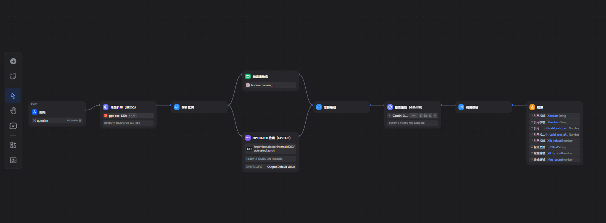
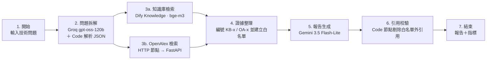
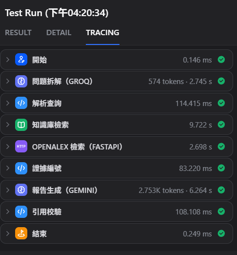
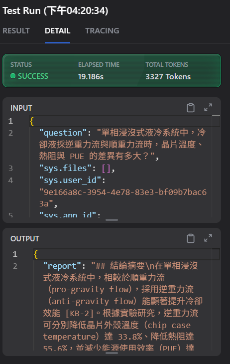
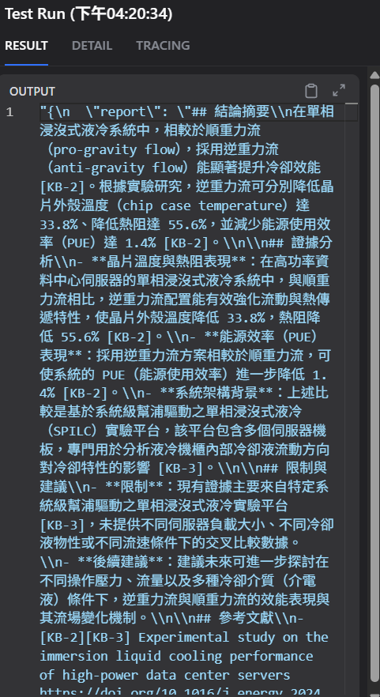

# CiteGuard-Energy

**以 Dify Workflow 打造的「防捏造引用」能源文獻調研 AI 工作流**


> 整條流程在 **Dify** 上編排：Dify Knowledge 知識庫 ＋ 外部 API（FastAPI → OpenAlex）兩路平行檢索 → LLM 撰寫報告 → Code 節點逐一校驗引用。工作流以 **Dify DSL** 版本控管，評測透過 **Dify Workflow API** 自動執行。



## 什麼是 CiteGuard？

**CiteGuard = Cite（引用）＋ Guard（守衛）**，也就是「引用守衛」；**-Energy** 代表它專門服務能源／節能領域（資料中心液冷、空調控制、AI 能耗）。

**要解決的問題**：用 LLM 查文獻時，最常見也最危險的錯誤是**捏造引用**——AI 會寫出「根據 Zhang et al. (2023)，浸沒式冷卻可節能 45%」這種看起來很專業、但論文或數字根本不存在的句子。

**CiteGuard 的做法**：不相信 LLM 自己說的出處，而是用程式確定性地把關。

1. **先找證據**：從自建論文知識庫與 OpenAlex 學術資料庫取回相關段落。
2. **證據編號＝白名單**：每份證據編成 `[KB-1]`、`[OA-2]`……，這份清單就是唯一合法的引用來源。
3. **每句都要附證據**：LLM 撰寫報告時，每個含數據或結論的句子都必須標註證據編號。
4. **守衛檢查**：Code 節點逐一比對報告中的編號——不在白名單的（例如 LLM 自創的 `[KB-9]`）直接剔除；引用全是捏造的句子整句刪除；最後自動附上真實的參考文獻與 DOI。
5. **不知道就說不知道**：問到證據中完全不存在的技術（評測中的捏造技術陷阱題），報告必須回答「【證據不足】」，不得編造數據。

**評測結果**：10 題全部成功、124 個引用 100% 可對應到真實證據、3 題捏造技術陷阱題全部正確拒答（詳見[評測](#評測)）。

**作者背景**：能源系學生，用 Dify 低程式碼編排加上自寫 API 整合，做出服務本科領域的 AI 工具，而不是通用聊天機器人。

## 用到的 Dify 功能

| Dify 功能 | 在本專案的用途 |
|---|---|
| **Workflow 編排**（9 個節點、平行分支） | 知識庫與 OpenAlex 兩路檢索同時執行，再匯流到證據編號節點 |
| **Knowledge 知識庫** | 15 篇論文；父子分段（父 1024／子 256）、混合檢索（語意 0.7＋關鍵字 0.3）、Top K 5 |
| **模型供應商外掛** | Ollama（本機 bge-m3 embedding）、Groq（問題拆解）、Gemini（報告生成） |
| **LLM 節點** | 問題拆解（中文問題 → 英文檢索查詢 JSON）、報告生成（強制每句附證據編號） |
| **Code 節點（Python 沙箱）** | 解析查詢、證據編號與白名單、引用校驗（確定性剔除捏造引用、計算有效引用率） |
| **HTTP Request 節點** | 呼叫本 repo 的 FastAPI 工具服務查 OpenAlex |
| **失敗重試／錯誤預設值** | LLM 節點自動重試；OpenAlex 失敗時改用空結果，流程不中斷 |
| **DSL 匯入匯出** | 工作流以 `dsl/citeguard_workflow.yml` 版本控管，由 `dsl/build_dsl.py` 產生 |
| **Workflow API**（`/v1/workflows/run`） | `eval/run_eval.py` 透過 API 自動跑 10 題評測 |

---

## 架構

工作流共 9 個節點（含開始／結束），兩路檢索平行執行，最後以白名單校驗引用：



- **兩路平行檢索**：本地知識庫提供全文細節，OpenAlex 補充最新、更廣的文獻摘要。
- **引用校驗白名單**：只有在第 4 步實際取得的證據編號才算合法，LLM 自己編出的 `[OA-9]` 之類引用會被移除；引用全是捏造的句子整句刪除，並輸出校驗前／校驗後有效引用率。
- **拒答**：問題中的技術在證據裡完全找不到（例如捏造的技術）時，報告以「【證據不足】」開頭，不編造數據；只有部分證據時照常回答並寫明限制。
- **容錯**：OpenAlex 失敗時 HTTP 節點回傳空結果，報告只用知識庫證據，流程不中斷；問題拆解重試 2 次、報告生成重試 3 次（Gemini 尖峰常回 503）。
- **分清「查無證據」與「檢索失敗」**：Dify 在知識庫檢索失敗（例如 Ollama 沒開）時只會回傳空結果，LLM 會誤以為「證據不足」。證據編號節點把空的知識庫結果與 OpenAlex 非 200 視為檢索失敗，報告最上方加上 ⚠️ 系統警告；評測腳本開跑前也會檢查 Dify、FastAPI、Ollama，檢索失敗的題目不計入拒答率。

## 技術選型

| 元件 | 選擇 | 說明 |
|---|---|---|
| 工作流編排 | **Dify 1.20 Workflow**（Docker Compose 自架） | 視覺化節點編排、內建知識庫、模型外掛、Workflow API |
| Embedding | bge-m3（Ollama，本機 GPU） | 多語言、支援中英混合查詢，資料不出本機 |
| 問題拆解 | Groq `openai/gpt-oss-120b` | 推理快，把中文問題拆成英文檢索查詢（JSON） |
| 報告生成 | Gemini `gemini-3.5-flash-lite`（thinking Low、關閉 Google 搜尋 grounding） | 速度快、免費額度足夠跑評測；關閉 grounding 確保只用給定證據 |
| 外部文獻 | OpenAlex（經本 repo 的 FastAPI 服務） | 免費開放學術資料庫；FastAPI 負責還原摘要、精簡欄位 |
| 引用校驗 | Dify Code 節點（Python） | 以證據白名單過濾引用 |

## Repo 結構

```
.
├── tools_service/         # FastAPI 工具服務（OpenAlex 搜尋）
│   ├── main.py
│   └── test_main.py       # pytest，假資料、不打網路
├── scripts/
│   └── pdf_to_kb_md.py    # PDF → 知識庫純文字（.txt）轉檔
├── dsl/
│   ├── citeguard_workflow.yml  # Dify Workflow DSL（由 build_dsl.py 產生，可直接匯入）
│   ├── build_dsl.py       # 產生 DSL：組裝節點、Prompt、Code 腳本
│   ├── nodes/             # 三個 Code 節點的 Python 腳本
│   ├── test_nodes.py      # Code 節點單元測試
│   └── kb_doi_map.json    # 知識庫文件 → DOI 對照
├── eval/
│   ├── golden_dataset.json  # 7 正常題 + 3 陷阱題
│   ├── run_eval.py        # 呼叫 Dify API、計算指標
│   └── results/           # 每次評測的 summary.md、results.json、逐題報告
├── examples/              # 範例輸出報告
├── docs/                  # 截圖
├── dois.txt               # 知識庫論文 DOI 清單
├── requirements.txt
├── .env.example
└── README.md
```

## 快速開始

### 1. 啟動 Dify（Docker）

依 [Dify 官方說明](https://github.com/langgenius/dify) 以 Docker Compose 啟動，瀏覽 `http://localhost` 完成初始化，並在「設定 → 模型供應商」加入 Groq 與 Gemini 的 API key。

### 2. 安裝 Ollama 與 bge-m3

```bash
ollama pull bge-m3
```

在 Dify 加入 Ollama 模型供應商，Base URL 填 `http://host.docker.internal:11434`，模型類型選 Text Embedding。

### 3. 啟動 FastAPI 工具服務（Windows 主機）

```powershell
python -m venv .venv
.\.venv\Scripts\activate
pip install -r requirements.txt
copy .env.example .env      # 填入 OPENALEX_API_KEY（OpenAlex 免費申請）
uvicorn tools_service.main:app --host 0.0.0.0 --port 8000
```

確認 `http://localhost:8000/health` 回傳 `{"status":"ok"}`。執行測試：

```powershell
pip install pytest
python -m pytest tools_service -q
```

### 4. 讓 Dify 能呼叫主機上的 FastAPI

Dify 的 HTTP／工具節點都經過 SSRF 防護代理，預設會擋 `host.docker.internal`。在 Dify 的 `docker/envs/infrastructure/ssrf-proxy.env` 加入：

```dotenv
SSRF_PROXY_ALLOW_PRIVATE_DOMAINS=host.docker.internal
```

再於 `dify/docker` 執行 `docker compose up -d ssrf_proxy`。只放行本機，其他內網位址仍會被擋。

### 5. 匯入工作流

知識庫建好後，用它的 ID（知識庫網址中的 UUID）產生 DSL，再到 Dify「工作室 → 匯入 DSL 檔案」匯入 `dsl/citeguard_workflow.yml`：

```powershell
python dsl\build_dsl.py --dataset-id <知識庫 ID>
python -m pytest dsl -q      # Code 節點單元測試
```

OpenAlex 這一路使用 HTTP 節點呼叫 FastAPI；FastAPI 也提供 `http://localhost:8000/openapi.json`，可另外匯入成 Dify 自訂工具（工具名稱 `openalex_search`）。

## 知識庫建置

本 repo **不附論文 PDF 與全文轉檔**（有版權）。請依 `dois.txt` 自行合法取得 PDF，放在 repo 根目錄後轉檔：

```powershell
# 需先安裝 Poppler 的 pdftotext 並加入 PATH
# 用法：python scripts/pdf_to_kb_md.py <PDF 資料夾> <輸出資料夾>
python -I scripts/pdf_to_kb_md.py . kb_md
```

腳本會移除參考文獻、致謝等章末內容與期刊頁首頁尾雜訊，並把論文內的數字引用（如 `[12]`）去除，避免與 `[KB-x]` 混淆。轉出的 `.txt` 位於 `kb_md/`（刻意不用 .md：Dify 解析 Markdown 會在每個標題處強制切段）（已被 `.gitignore` 排除），再上傳到 Dify Knowledge，設定如下：

| 項目 | 設定 |
|---|---|
| 分段模式 | 父子分段 |
| 父段 | 分隔符 `\n\n`，最大長度 1024 |
| 子段 | 分隔符 `\n`，最大長度 256 |
| Embedding | bge-m3（Ollama） |
| 檢索方式 | 混合檢索，語意 0.7 / 關鍵字 0.3 |
| Top K | 5 |

## 評測

用 `eval/run_eval.py` 呼叫 Dify Workflow API（`/v1/workflows/run`），跑 `eval/golden_dataset.json` 的 10 題：7 題正常題（每題對應知識庫中一篇論文，並標註應出現的關鍵數字）＋ 3 題陷阱題（捏造的節能技術，例如「石墨烯超導冷媒 GrapheneFreeze-7」）。

```powershell
python eval\run_eval.py                 # 結果存到 eval/results/<時間>/
python eval\run_eval.py --rescore <資料夾>  # 修改計分規則後，用已存報告重新計分
```

**最新結果**（`eval/results/20261126-162145`，報告模型 gemini-3.5-flash-lite；與前一輪 20261126-131739 結果一致）：

| 指標 | 結果 |
|---|---|
| 成功執行 | 10 / 10 |
| 引用總數 | 124 |
| 有效引用率：校驗前（baseline）→ 校驗後 | 100% → 100% |
| 陷阱題拒答率 | 3 / 3（100%） |
| 正常題回答率 | 6 / 7（85.7%） |
| 來源命中率（正常題引用到預期論文） | 7 / 7（100%） |
| 關鍵數據命中率（正常題） | 80% |
| 平均耗時 | 10.2 秒 / 題 |

**分析（照實記錄）**

- **引用校驗這一輪沒有剔除任何引用**：在嚴格的引用規則 Prompt 下，Gemini 沒有捏造編號，所以校驗前後都是 100%。校驗節點是確定性的保險，這次沒有觸發；要展示它的效果，下一步是加一組對照實驗（較弱的模型或無引用規則的 Prompt）。
- **陷阱題全部正確拒答**：三個捏造技術都回答「【證據不足】」，沒有編造數據。
- **N4 誤拒答（檢索限制）**：論文中明確寫有「每年可避免 1488 tCO2e」，但知識庫檢索取回的是成本公式段落，報告因此判斷證據不足。屬於檢索召回問題，不是生成捏造；可改善方向是提高 Top K 或對摘要／結論段落加權。
- **計分 bug 已修正**：第一版只在報告第一個字找「【證據不足】」，LLM 若先寫標題就會漏判，N4 一度被誤算為「有回答」；已改為檢查開頭段落並重新計分。
- **免費額度**：gemini-3.7-flash 免費版每日僅 20 次請求，一輪評測即用完，因此改用 gemini-3.5-flash-lite。

## 截圖

Dify Workflow 畫布見頁首。一次實際執行（N1 逆重力流問題）：9 個節點全部成功，總耗時約 19 秒，兩路檢索平行執行。

| 節點追蹤（Tracing） | 輸入與輸出（Detail） |
|---|---|
|  |  |

<details>
<summary>結束節點的原始輸出（JSON）</summary>



</details>

## 範例輸出

- [`examples/N1_immersion_flow_direction.md`](examples/N1_immersion_flow_direction.md)：正常題，逆重力流降低晶片溫度 33.8%、熱阻 55.6%，每句附證據編號與 DOI。
- [`examples/T2_trap_fabricated_refrigerant.md`](examples/T2_trap_fabricated_refrigerant.md)：陷阱題，捏造的冷媒正確回答【證據不足】。

## 版權說明

- 知識庫論文版權屬原出版者與作者，本 repo 僅提供 DOI 清單（`dois.txt`）與轉檔腳本，不散布 PDF 或全文。
- OpenAlex 資料依其 CC0 授權使用。
- 本專案程式碼以 [MIT License](LICENSE) 授權。

---

作者：[ck-x-x](https://github.com/ck-x-x)
